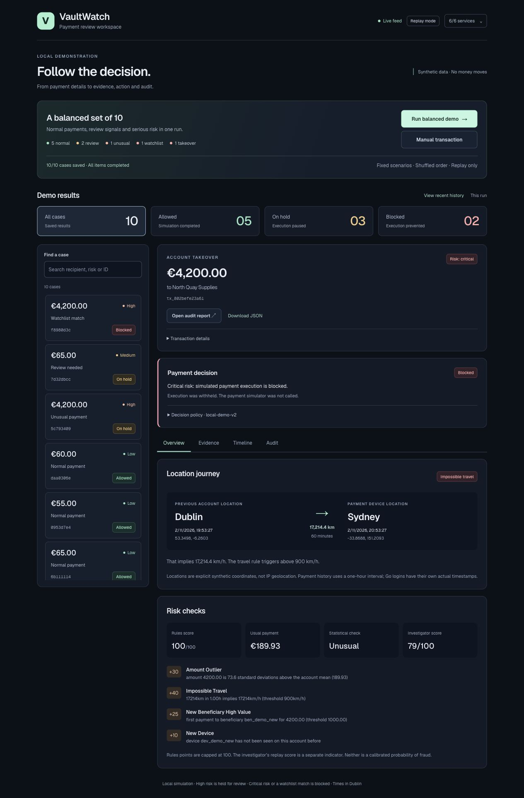
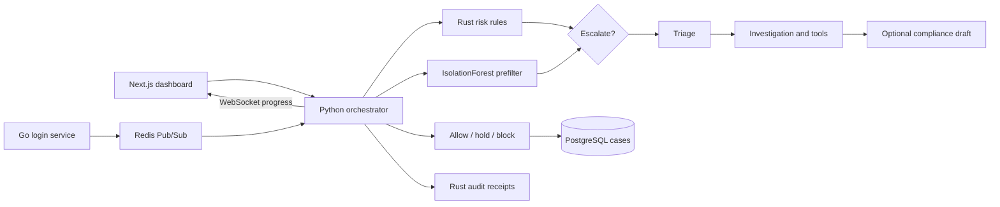

# VaultWatch

[](https://github.com/Assembler-Fourier/vaultwatch/actions/workflows/ci.yml)

A local fraud and account-security review workspace built with **Rust, Go, Python, Next.js, PostgreSQL and Redis**.

Run a synthetic payment, follow the risk checks, inspect the investigation evidence, and see why simulated execution was allowed, held or blocked. Account-takeover scenarios connect real local login requests, Redis events and transaction processing.

**All accounts, payments, locations and watchlist entries are synthetic. No money moves.** The recommended local setup uses deterministic model replay, so no API key or paid model call is required. Optional Anthropic inference is a separate configuration, not the mode shown below.



[Quick start](#quick-start) · [Architecture](docs/architecture.md) · [Local guide](docs/local-development.md) · [Model modes and limits](docs/model-modes.md)

## Quick start

You need Git, Docker with Compose **2.24.4+**, and Python 3 on the host for verification. Start Docker Desktop or another compatible Docker engine first.

```sh
git clone https://github.com/Assembler-Fourier/vaultwatch.git
cd vaultwatch
./scripts/local-demo.sh start
```

Open **[localhost:3000](http://localhost:3000)**. The API explorer is at **[localhost:8000/docs](http://localhost:8000/docs)**.

```sh
./scripts/local-demo.sh doctor  # read-only health and audit checks
./scripts/local-demo.sh verify  # create and check five synthetic cases
./scripts/local-demo.sh stop    # stop while keeping saved data
```

The launcher builds the four application services, starts PostgreSQL and Redis, and waits for readiness. All published ports bind to `127.0.0.1`. The `vaultwatch-study` project name preserves the same database and audit volumes across restarts.

## Try a case

Click **Run balanced demo** for ten cases: five normal, two review, one unusual, one watchlist and one takeover. The expected default replay outcome is **5 allowed, 3 held and 2 blocked**.

Or expand **Manual transaction**, choose a scenario and run one case:

| Scenario | What it demonstrates | Default replay outcome |
|---|---|---|
| Normal payment | Familiar device, recipient and amount | Allowed simulation |
| Review needed | Several small payments from a new device | Held for review |
| Unusual payment | Large amount, new recipient/device and distant location | Held for review |
| Watchlist match | A fabricated recipient matches the synthetic list | Blocked |
| Account takeover | Go login warnings correlate with the same payment account | Blocked |

Changing the amount or locations can change the result. The batch runs sequentially inside one HTTP request; it is not a durable queue. If the request disconnects, inspect recent cases before rerunning it.

Select a case to explore **Overview, Evidence, Timeline and Audit**. Download its JSON record or open the printable report. Existing records retain their original policy version; older records without payment controls show **Not evaluated**.

## How it works



| Component | Responsibility |
|---|---|
| [Rust](engine-rust) | Deterministic risk rules and a file-backed SHA-256 audit chain |
| [Go](gateway-go) | Password hashing, rotating tokens, rate limiting and login-anomaly signals |
| [Python](agents-python) | Synthetic scenarios, model-provider abstraction, investigation tools, security correlation and payment policy |
| [Next.js](dashboard-web) | Case review, evidence, timelines, status and report links |
| PostgreSQL | Accounts, refresh tokens and saved case JSON |
| Redis | Live login/security events between Go and Python |

Replay investigation reads the same tool results as the model-driven workflow, including history, entity links and the fabricated watchlist. Clear cases can stop before any model stage. See the [architecture guide](docs/architecture.md) for execution and persistence boundaries.

## Two dashboard modes

- **Full local mode:** the complete multi-service workspace shown here, with persisted cases, login-signal fusion, payment decisions and reports.
- **[Public showcase](https://dashboard-web-three-sable.vercel.app):** a separate, smaller TypeScript financial-risk demonstration. It uses a heuristic prefilter and instance-memory history/audit. It does not implement the full local payment controls or Go/Redis security fusion. Publishing this repository does not by itself prove which version that deployment serves.

See [model modes](docs/model-modes.md) for replay, optional live inference and configuration.

## Verification

The local `verify` command checks five scenarios, PostgreSQL readback, report exports, evidence consistency, audit receipts and invalid input rejection. It requires replay mode and creates synthetic records.

CI runs on **pull requests and pushes to `main`**:

- Rust formatting, Clippy and tests.
- Go build, vet and race tests.
- Python Ruff and pytest.
- Dashboard ESLint, TypeScript checking and production build.

The [local guide](docs/local-development.md) includes commands and recovery checks. CI unit/build checks and local end-to-end verification are separate evidence.

## Scope and limits

This is an engineering demonstration, not a production fraud or banking platform. Risk scores are not calibrated probabilities; the statistical model is trained on synthetic data. Holds have no release workflow. There is no bank, real payment provider or regulatory submission.

The audit verifies its local hash chain. It does not independently authenticate evidence or cross-check every database field against a receipt. The final simulation receipt is saved in PostgreSQL after the policy audit entry. Redis Pub/Sub does not replay missed events, and direct Python/Rust endpoints are not protected by the Go login service.

Use the loopback-only local profile. Public deployment requires separate authentication, secret management and operational work. [Details and failure boundaries](docs/architecture.md#failure-boundaries).

## License

[MIT](LICENSE).
